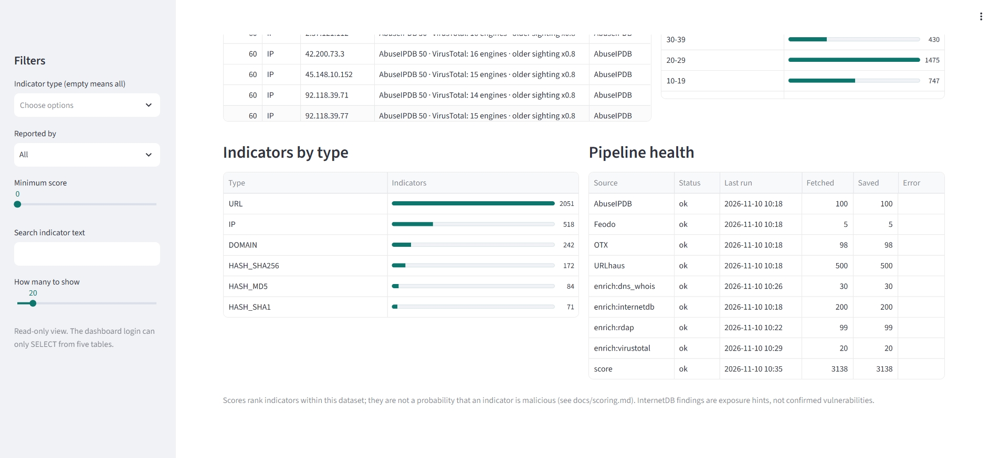

# Cyber Threat Intelligence Pipeline

A lab-scale threat intelligence pipeline. It ingests indicators from four public feeds, stores them in PostgreSQL, enriches them, gives each one an explainable 0-100 score, and shows the results in a read-only dashboard.



## Highlights
- Explainable score: the reasons behind every score are stored with it.
- Four feeds (AbuseIPDB, OTX, Feodo Tracker, URLhaus), enriched with InternetDB, RDAP, DNS/WHOIS and VirusTotal.
- Read-only dashboard that logs in as a SELECT-only database role and listens on localhost only.
- Offline tests and per-source run status.

## Phases
1. Environment setup (Ubuntu VM, Python, PostgreSQL, Docker, Git)
2. Feed ingestion (AbuseIPDB, Feodo Tracker, OTX, URLhaus; MISP not implemented)
3. Enrichment (WHOIS/DNS, Shodan InternetDB, VirusTotal reputation)
4. Scoring (explainable 0-100 score per indicator)
5. Dashboard (read-only Streamlit view over the data)
6. Regional tagging (indicators registered in East Africa, from RIR data)

## Status
Phase 1 complete.

Phase 2 (feed ingestion) complete: AbuseIPDB, OTX, Feodo Tracker and URLhaus are ingested and cleaned on a daily schedule, with an overlap view and offline tests. VirusTotal moves to Phase 3 (enrichment); MISP is not implemented. See [docs/feeds.md](docs/feeds.md).

Phase 3 (enrichment) complete: IPs are enriched with InternetDB and RDAP ownership data, domains with DNS and WHOIS age, and priority indicators with VirusTotal reputation, on a daily schedule with offline tests. See [docs/enrichment.md](docs/enrichment.md).

Phase 4 (scoring) complete: every indicator gets a 0-100 score with a stored breakdown built from feed confidence per source, feed overlap, VirusTotal detections, domain age and freshness. Two models (v1 and v2) can be compared on the same data, and v2 runs daily as the last step of the pipeline. See [docs/scoring.md](docs/scoring.md).

Phase 5 (dashboard) complete: a read-only Streamlit dashboard shows indicators, score breakdowns, feed overlap and pipeline health. It listens on localhost only and is viewed through an SSH tunnel. See [docs/dashboard.md](docs/dashboard.md).

Phase 6 (regional tagging) complete: indicators are tagged when their IP is registered in an East African country (AFRINIC delegation file) or their domain uses a regional TLD, as the start of a comparison between global feeds and the region. Tags mean registered in, not hosted in. See [docs/regional.md](docs/regional.md).

## Quick start
Needs Ubuntu, Python 3, PostgreSQL and free API keys for AbuseIPDB, OTX, VirusTotal and abuse.ch (Feodo Tracker and URLhaus). The scripts assume the repo lives at `/opt/cti`.

```bash
git clone https://github.com/michprojects-NCS/cti-pipeline.git /opt/cti
cd /opt/cti
python3 -m venv venv && source venv/bin/activate
pip install -r requirements.txt

cp .env.example .env && chmod 600 .env      # then add your keys and passwords

psql "$DATABASE_URL" -f schema.sql
psql "$DATABASE_URL" -f sql/overlap_view.sql
psql "$DATABASE_URL" -f sql/scores_table.sql
psql "$DATABASE_URL" -f sql/last_seen.sql
psql "$DATABASE_URL" -f sql/indicator_geo.sql
psql "$DATABASE_URL" -f sql/dashboard_role.sql   # set the dashboard password first

bash scripts/daily_run.sh        # ingest, enrich, score
bash scripts/run_dashboard.sh    # dashboard on 127.0.0.1:8501
pytest -q                        # offline tests
```

## Limitations
- Free-tier API limits keep the data small; this is a lab, not a production feed.
- Scoring weights are hand-set and not validated against ground truth. The score ranks indicators within this dataset; it is not a probability of malice.
- MISP is not implemented, and it runs on a single machine.

## Data and license
No feed data is included. Each feed has its own terms, and you supply your own API keys. MIT license; see [LICENSE](LICENSE).
