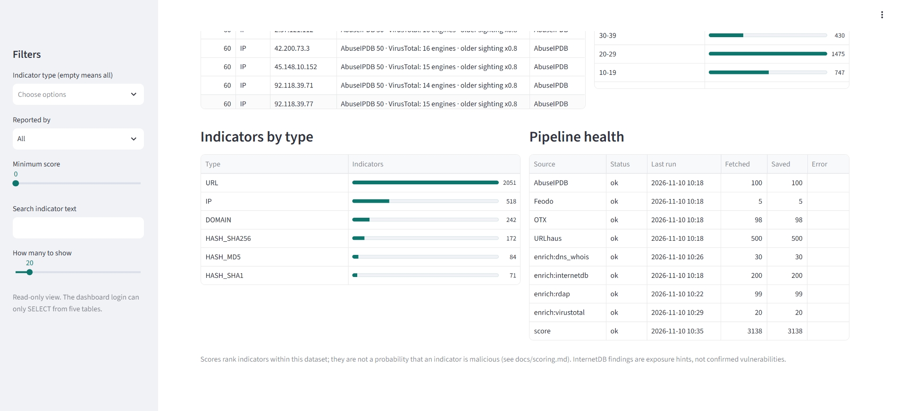

# Dashboard

A read-only Streamlit dashboard over the pipeline's database: indicators, their scores and the reasons behind them, feed overlap, and the health of each pipeline run.




## Access

The dashboard listens on `127.0.0.1:8501` only and is not exposed to the network. View it from your own computer through an SSH tunnel:

```bash
ssh -L 8501:127.0.0.1:8501 <user>@<vm-address>
```

Then open http://localhost:8501 in a browser. It has no login of its own, so keep it bound to localhost.

## What it shows

| Panel | Meaning |
|---|---|
| Headline numbers | Totals for the whole dataset. |
| Indicators by type | Count of IPs, domains and so on. |
| Score distribution | Indicators per 10-point band of the 0-100 score. |
| Indicator table | Score, the main reasons for it (**Why**), and which feeds listed it (**Reported by**). |
| Latest pipeline run | `ok` if the newest run of every source succeeded; `attention` if a source failed or never ran. |
| Pipeline health | Newest run per source, failed ones first, with items fetched and saved. |
| InternetDB | Open ports and vulnerability findings for IPs. Exposure hints only; they do not change the score. |

Filters are in the sidebar: indicator type, feed, minimum score, region and a text search over indicator values. Region shows where an address is registered (see [regional.md](regional.md)); blank means no match or not testable. Leaving the type box empty shows every type.

**The score is a ranking, not a probability.** It orders indicators by how strongly the evidence points at them relative to the rest of this data. See [scoring.md](scoring.md) for the exact weights.

## Security design

- **Read-only database role.** The dashboard connects as a dedicated role that can only read. The connection string is `DASH_DATABASE_URL` in `.env`, which is not committed.
- **Localhost only.** The listener is bound to `127.0.0.1` in `.streamlit/config.toml`.
- **No writes.** Every panel is a query in `dashboard/queries.py`, and the tests check that each query is read-only.
- **Parameterised filters.** User input is passed as query parameters, never pasted into SQL, and the text search escapes `%`, `_` and backslash so they cannot act as wildcards.

## Operating it

```bash
# install the service (once)
sudo cp scripts/cti-dashboard.service /etc/systemd/system/
sudo systemctl daemon-reload && sudo systemctl enable --now cti-dashboard

# day to day
sudo systemctl status cti-dashboard
sudo systemctl restart cti-dashboard
journalctl -u cti-dashboard -n 50 --no-pager

# run in the foreground for debugging
bash scripts/run_dashboard.sh
```

## Troubleshooting

- **"Cannot read from the database"**: check `DASH_DATABASE_URL` in `.env` and that PostgreSQL is running.
- **Page does not load**: confirm the tunnel is open and the service is active.
- **Pipeline health shows `attention`**: open the Pipeline health panel and look at the failed source first.

## Tests

```bash
pytest tests/test_dashboard_queries.py tests/test_dashboard_app.py
```
Both run offline, with no database or network.
